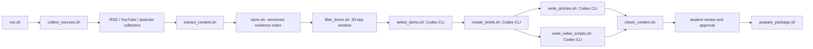

# Problem Set 4 Student Submission

Complete this document with your project details and links. Keep the course instructions in [README.md](README.md) and the required contracts in [ARCHITECTURE.md](ARCHITECTURE.md).

**Student:** To be filled in before submission
**GitHub repository:** https://github.com/LShao-projects/MIT1.125-ass4

## Topic and Audience

- **Publication name:** Suno in Practice
- **Topic:** How recent Suno creator-tool changes affect independent music making, what current tests can and cannot show, and what creators should verify before releasing Suno-assisted work.
- **Audience and assumed knowledge:** English-speaking independent songwriters and producers who make demos or releases, understand basic recording and editing, and are considering Suno as one step in their workflow.
- **Central question:** Can independent musicians turn their own ideas into music they would feel ready to release with Suno's help?
- **Scope and exclusions:** Three connected pieces address (1) recent workflow changes, (2) evidence about sound and control, and (3) documentation, terms, and platform treatment around a release. Generic AI-business news and unrelated music-industry articles are excluded. Litigation and investigations are reported according to their procedural status, without legal advice.
- **Reason for readers to return:** Product features, independent tests, and platform rules can change. The series gives readers a repeatable way to check what changed and what remains unproven.

## Published Series

All three articles were published on October 15, 2026 as free, web-only posts with the audience set to Everyone. Their public pages display the companion YouTube video and source list.

| Piece | Title | Substack article | YouTube video |
| --- | --- | --- | --- |
| 1 | Suno Studio’s October update meets the work creators already do | [Read article](https://ls12379796.substack.com/p/suno-studios-october-update-meets) | [Google Vids source](https://docs.google.com/videos/d/1QGUjI7MjzG8ppmZwoahAhCcsOjDzBWEbcNfdt3TIGiI/edit); [final MP4](production/final_videos/episode_01_final.mp4); [YouTube video](https://youtu.be/7YWS037HVgs) |
| 2 | What Suno quality tests can actually tell you | [Read article](https://ls12379796.substack.com/p/what-suno-quality-tests-can-actually) | [Revised Google Vids source](https://docs.google.com/videos/d/15lv-aWG106kU3G_V_t6XZI2uZyG7v2l8EaSTbNsrDo4/edit); [final MP4](production/final_videos/episode_02_final.mp4); [YouTube video](https://youtu.be/6avganzCYio) |
| 3 | Before releasing a Suno-assisted song, trace what went in and what comes out | [Read article](https://ls12379796.substack.com/p/before-releasing-a-suno-assisted) | [Google Vids source](https://docs.google.com/videos/d/1wNxcN_VxEQyvh-TzhrERDhiQD_qjLUa1JcHxoVnk6Z8/edit); [final MP4](production/final_videos/episode_03_final.mp4); [YouTube video](https://youtu.be/SVlGeaCmVcs) |

**Separate technical demonstration video:** Not yet recorded

## Setup and Execution

This implementation uses Bash, Python 3 (tested with 3.14.8), `yt-dlp` (tested with 2026.08.19), `ffmpeg` (tested with 9.0.2), and Codex CLI (tested with 0.155.1) signed in to a ChatGPT account. No separate API key is required for the editorial and writing steps. The CLI is called with an ephemeral, read-only working directory and a structured JSON output schema. Install these tools using your platform's package manager and run `codex login` before the first model-backed run. Python processing uses the standard library. If a podcast has no publisher transcript, set `WHISPER_CLI` to a local `whisper-cli` executable and `WHISPER_MODEL` to an English model file; `ffmpeg` decodes a temporary WAV outside the repository and the temporary file is removed. The current podcast sources have timestamped transcripts. After student authorization, audio-only copies of the four accepted YouTube and podcast items were retained in `data/media/` for evidence inspection; no video picture files were saved or played.

Edit `config/project.json` for the publication, topic, audience, and central question; `config/sources.json` for RSS, YouTube, and podcast endpoints; `config/supplemental_urls.json` for additional original webpages; `config/editorial_policy.md` for selection and credibility rules; and the four files in `prompts/` for model instructions. Each run snapshots the exact files it used. Normal collection needs network access. No credentials or media bytes are committed in configuration.

After implementation, the required entry commands are:

```bash
bash run.sh
bash run.sh --package runs/RUN_ID
```

Replace `RUN_ID` with an actual live run directory. The first command collects sources, selects evidence, creates three briefs, drafts three articles and video scripts, and checks them. It stops with `awaiting_review` when checks pass. The second command requires a matching `approval.json` supplied by the student after reviewing the actual drafts. It does not recollect or regenerate content.

To rerun just the selection stage on an existing saved corpus, use `bash editorial/select_items.sh runs/RUN_ID < runs/RUN_ID/eligible.jsonl > runs/RUN_ID/decisions.jsonl`. Other stages accept the same `RUN_DIR` contract and JSONL stream inputs described in `ARCHITECTURE.md`. Do not overwrite a submitted run's decisions when comparing policies; copy the evidence and new policy snapshot into a separately labeled run first.

## Architecture and Manual Handoffs



The 16 required Bash files each perform their stated orchestration or component responsibility. Focused Python helpers handle RSS and transcript parsing, SQLite storage through `data/store.sh`, model result validation, and content checks. The persistent SQLite index is under `data/evidence/`; only `data/store.sh` accesses it directly. It stores stable item identities, version records, and run observations, rather than media bytes. Retained source text and timestamped transcript segments are under `data/assets/`. Audio-only files for accepted YouTube and podcast items are under Git-ignored `data/media/`, with file hashes and paths in the run’s `retained_media.jsonl`. The optional `processing/extract_content.sh RUN_DIR --retain-accepted-media` mode performs this post-selection retrieval and reuses verified files on repeat runs. Runs, prompts, decisions, briefs, drafts, receipts, checks, and snapshots are under `runs/RUN_ID/`.

The student has reviewed three accepted and three rejected AI selection decisions; see the review record below. After a live run, the student must read `articles/01.md`–`03.md`, `video_scripts/01.md`–`03.md`, and `review.json`; correct any factual or interpretive problem and record why. Only the student may create `approval.json` for the current `review_id`. `prepare_package.sh` then checks that the approval still matches the evidence and drafts and assembles six approved texts plus per-piece source notes. The student reviewed the three final audience videos, uploaded them to YouTube, and published the matching Substack articles. The technical demonstration remains a manual handoff. The package's `publication_links.json` now records the live article and video URLs.

The student rejected the first static diagram look for the Google Vids scenes. Its unused rendered slides were removed. A later creator-studio draft was also revised after the student found the repeated person-at-computer shots uninformative. A diagram revision still felt like a slide deck, so the [visual-production handoff](production/workbench/google_vids_v2/README.md) now supplies animated demonstrations of the editing decisions, with reproducible scene renderers and a [scene-by-scene edit plan](production/workbench/google_vids_v2/VIDS_EDIT_PLAN.md). All three episodes have local review exports and private Google Vids sources linked above. They use English Tova AI voiceover and a common caption style. Episode 3's dissolves were removed after they caused overlap. The [video QA report](production/workbench/google_vids_v2/series_review/QA_REPORT.md) documents timing and sampled-frame checks; the student has now reviewed the final exports. The three reviewed exports have been uploaded as unlisted YouTube videos and their metadata checked on October 15.

The current six- and seven-scene video storyboards were manually revised after the first live run in response to student feedback. The changes and evidence checks are recorded in `runs/live-20261013T181427Z/editorial_corrections.md`; the story structure, alternative hooks, visual plans, and claim ledger are in `production/editorial/storytelling_review.md`. The first run's prompt snapshot remains unchanged as a record of what generated the initial scripts. The top-level `prompts/write_video_scripts.md` has since been revised to request this storyboard format. The second live run exercised that prompt; its newly generated drafts still require student review.

## Evidence and Runs

The first reviewed and approved live run is [live-20261013T181427Z](runs/live-20261013T181427Z/run.json). Its [summary](runs/live-20261013T181427Z/summary.json) reports 20 newly discovered candidates, 20 extracted items, 21 eligible items after including one still-current prior store record, 13 accepted, 8 rejected, and three article/video-script pairs. The [decisions](runs/live-20261013T181427Z/decisions.jsonl), [briefs](runs/live-20261013T181427Z/briefs.jsonl), [article manifests](runs/live-20261013T181427Z/articles.jsonl), [script manifests](runs/live-20261013T181427Z/video_scripts.jsonl), and [content review](runs/live-20261013T181427Z/review.json) provide the trace. Original text and timestamped transcript segments are under `data/assets/`, at the paths named by `eligible.jsonl`. The versioned index is `data/evidence/index.sqlite3`; query it through `bash data/store.sh get ITEM_ID [VERSION_ID]`. Run receipts are under `logs/`.

The [actual-use reconciliation](runs/live-20261013T181427Z/actual_usage.jsonl) distinguishes each accepted item's intended article assignments from the pieces that actually cite it. One accepted podcast was not used in any final brief or draft; three other items assigned to piece 02 were used only in pieces 01 or 03. This is recorded rather than counted as additional support for piece 02. The second run separately records intended assignments; a final actual-use comparison should still be checked before publication.

The first live collection run fetched YouTube metadata and English caption text, and used publisher podcast transcripts or a saved pilot transcript; it did not fetch media bytes at that stage. After the student authorized keeping only needed evidence, the four accepted YouTube and podcast sources were retrieved as **audio only** into Git-ignored `data/media/` (about 71 MB total). This was a documented post-run retention step, recorded in [retained_media.jsonl](runs/live-20261013T181427Z/retained_media.jsonl) and its stage receipts; it was not part of the original 372.6-second run. Replaying it reused all four verified files without downloading again. The updated workflow now calls this accepted-media step automatically after selection, and the second live run reused all four files after hash verification. No video picture file was saved or played. If a future episode lacks transcript text, the optional `ffmpeg`/Whisper fallback streams audio into a temporary file and removes it after transcription.

| Run | Actual date | Run artifacts and logs | Elapsed time | Approximate cost |
| --- | --- | --- | --- | --- |
| First live run | 2026-10-13 UTC | [Run folder](runs/live-20261013T181427Z/run.json) and [logs](runs/live-20261013T181427Z/logs/) | 372.6 seconds (first complete run; later editorial edits tracked separately) | Model cost unavailable from Codex CLI; local parsing stages reported zero estimated direct cost |
| Second live run | 2026-10-14 UTC | [Run folder](runs/live-20261014T010222Z/run.json), [summary](runs/live-20261014T010222Z/summary.json), [recovery record](runs/live-20261014T010222Z/recovery.md), and [logs](runs/live-20261014T010222Z/logs/) | 547.1 seconds including recovery | Model cost unavailable from Codex CLI; local parsing stages reported zero estimated direct cost |
| Third live run | 2026-10-14 EDT | [Run folder](runs/live-20261014T155641Z/run.json), [summary](runs/live-20261014T155641Z/summary.json), [comparison](runs/live-20261014T155641Z/comparison.md), and [logs](runs/live-20261014T155641Z/logs/) | 482.3 seconds | Model cost unavailable from Codex CLI; local parsing stages reported zero estimated direct cost |

The first and third complete runs occurred on different **New York calendar dates** (October 13 and 14 EDT). The second run's October 14 UTC timestamp was still October 13 EDT; the third run removes that ambiguity. Its [comparison](runs/live-20261014T155641Z/comparison.md) identifies two new, unrelated records that were rejected and two version changes; all newly generated drafts remain unapproved. The first-run student-approved package remains the publication base. The earlier [comparison](runs/live-20261014T010222Z/comparison.md) and [actual-use reconciliation](runs/live-20261014T010222Z/actual_usage.jsonl) remain available. The first run's `changes.jsonl` records 1 new and 19 unchanged items. A [same-input replay](runs/live-20261013T181427Z/replay/README.md) upserted the same 20 records again and produced 20 `unchanged` results; the store interface returned 21 latest items before and after. A separate [simulated RSS failure replay](runs/failure-replay-20261013/README.md) used a deliberately unreachable endpoint. The collector reported failure, while the workflow preserved 20 valid candidates and marked its final collection status incomplete. These labeled replays do **not** count as the required different-day live run. An additional [failed sandbox-network attempt](runs/live-20261014T155627Z/summary.json) immediately before the third run is retained as an incomplete attempt, not counted as a successful run. Date filtering and its exclusions are in each run's `eligible.jsonl` and `exclusions.jsonl`; these runs had zero exclusions. Model receipts give token usage, but Codex CLI did not supply a USD cost; this is unknown, not zero.

Because the saved live runs have zero date exclusions, a separate [clearly labeled synthetic date-boundary replay](runs/date-window-replay-20261015/README.md) shows the filter excluding a September 15 item as `outside_window` and admitting a September 16 item for an October 15 run. These synthetic records are not article evidence or a substitute for a live run. The updated accepted-media route now retrieves and retains audio-only source content after editorial selection, while transcripts still provide timestamped evidence locators. The first run's post-run audio retention is labeled separately; the second run automatically verified and reused those files. The initial selection failure and its recovery are documented separately. Large audio files are intentionally ignored by Git; the manifest records source URLs, paths, sizes, and SHA-256 hashes so they can be retrieved or verified locally.

One published claim trace: [article 03](https://ls12379796.substack.com/p/before-releasing-a-suno-assisted) recommends keeping an original demo and lyric sheet. It maps to [brief 03](runs/live-20261013T181427Z/briefs.jsonl), the accepted JG Beats Lab podcast item in [decisions](runs/live-20261013T181427Z/decisions.jsonl), version `9efc2662c9fde6a11cc2`, and the timestamped transcript segments listed in the brief at about 11:30–11:50. The public article attributes this documentation practice to the podcast and does not present it as a legal rule.

## Editorial Review

The working [editorial policy](config/editorial_policy.md) and [four prompts](prompts/) are snapshotted in every run. The student inspected [three accepted and three rejected decisions](runs/editorial-pilot-20261013/review_queue.md), agreed with each AI decision, and supplied specific reasons. The accepted Deezer report is used only as a planned, conditional discoverability example. The accepted JG Beats Lab episode contributes an attributed documentation practice, not an independently established legal rule. The borderline rejected Madverse interview mentions AI-assisted distribution checks but provides no documented Suno-specific result or generally applicable rule.

The [original policy snapshot](runs/editorial-pilot-20261013/config/editorial_policy.md), [revised policy snapshot](runs/editorial-policy-rerun-20261013/config/editorial_policy.md), and [comparison](runs/editorial-policy-rerun-20261013/comparison.md) show the targeted piece-03 relevance rule and rerun on the same 20 source versions. It changed no accept/reject decisions or piece assignments; it made the reasons more precise. During review, the Suno Studio release-note passage was corrected from a conversational September description to its October 8 date. The live run has a separate [draft alignment log](runs/live-20261013T181427Z/editorial_corrections.md) for an assistant edit before student draft review. **Student review of the three articles and scripts was confirmed in chat and recorded in the first run’s `approval.json` for review ID `ed0071363587f6a5e78365822ee1f26850147a62c5c8922558730024e409243a`. The production handoff package is under `runs/live-20261013T181427Z/package/`. The student reviewed the three final audience videos on October 15 and verified that all three published articles open without login.**

## Reflection

**Working reflection, to revisit after final student review:** The quality comparisons in piece 02 measured different properties with different inputs; connecting them yields a more useful question about what each test can establish than a single “v6 is better” verdict. A current limitation is that the first generated piece-03 video script omitted one article claim about a producer's limited use of Suno; the checker warned about mismatched claim sets, and the script was aligned before student review. A useful next improvement is to make central-claim parity between paired drafts a blocking check while still allowing a video to omit secondary detail. The main storage tradeoff was choosing SQLite behind `data/store.sh`: it gives stable identities, version history, and idempotent upserts, at the cost of a schema and database dependency. All other components use the store interface, which makes the tradeoff contained and testable.
