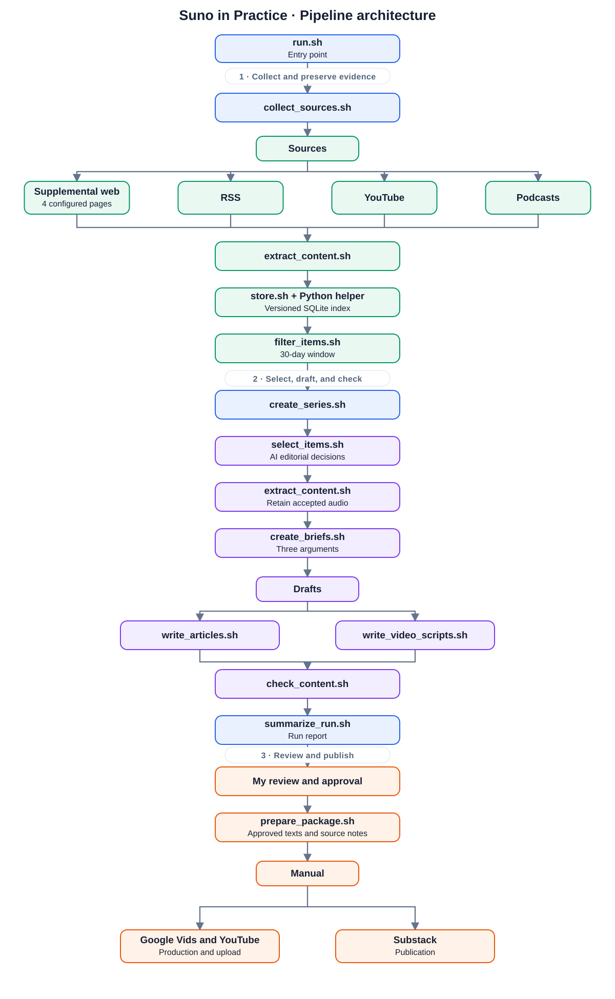

# Problem Set 4 Student Submission

**Student:** Liuyixin Shao
**GitHub repository:** https://github.com/LShao-projects/MIT1.125-ass4

## Topic and Audience

- **Publication name:** Suno in Practice
- **Topic:** What Suno's recent updates mean for musicians: where they help, what the available tests show, and what to check before releasing a song made with Suno.
- **Audience and assumed knowledge:** Independent songwriters and producers who read English, know the basics of recording and editing, and are thinking about using Suno for a demo or release.
- **Central question:** Can independent musicians turn their own ideas into music they would feel ready to release with Suno's help?
- **Scope and exclusions:** The three pieces cover recent workflow changes, tests of sound and control, and the records and rules a musician may need to check before a release. The series leaves out general AI business news and music-industry stories that do not bear on this question. It describes lawsuits and investigations as ongoing proceedings, without giving legal advice.
- **Reason for readers to return:** Suno's tools and platform rules may change. New tests may also answer questions the current ones leave open. The series shows readers what to check as that happens.

## Published Series

All three articles were published on October 15, 2026 as free, web-only posts with the audience set to Everyone. Their public pages display the companion YouTube video and source list.

| Piece | Main point | Substack article | YouTube video and production files |
| --- | --- | --- | --- |
| 1. Suno Studio’s October update meets the work creators already do | Suno announced more clip and timing controls. Existing creator accounts show why editing matters, but none tests whether the October controls improve a finished song. | [Read article](https://ls12379796.substack.com/p/suno-studios-october-update-meets) | [Watch video](https://youtu.be/7YWS037HVgs); [Google Vids source](https://docs.google.com/videos/d/1QGUjI7MjzG8ppmZwoahAhCcsOjDzBWEbcNfdt3TIGiI/edit); [final MP4](production/final_videos/episode_01_final.mp4) |
| 2. What Suno quality tests can actually tell you | Recent tests measure different files and outcomes. A musician should check both the exported sound and whether the result follows their own idea; these small tests do not establish a general verdict on v6. | [Read article](https://ls12379796.substack.com/p/what-suno-quality-tests-can-actually) | [Watch video](https://youtu.be/6avganzCYio); [Revised Google Vids source](https://docs.google.com/videos/d/15lv-aWG106kU3G_V_t6XZI2uZyG7v2l8EaSTbNsrDo4/edit); [final MP4](production/final_videos/episode_02_final.mp4) |
| 3. Before releasing a Suno-assisted song, trace what went in and what comes out | A creator can document their own inputs, Suno's output, and later edits, then check the terms and platform rules that apply to their release. That record does not itself settle ownership or distribution. | [Read article](https://ls12379796.substack.com/p/before-releasing-a-suno-assisted) | [Watch video](https://youtu.be/SVlGeaCmVcs); [Google Vids source](https://docs.google.com/videos/d/1wNxcN_VxEQyvh-TzhrERDhiQD_qjLUa1JcHxoVnk6Z8/edit); [final MP4](production/final_videos/episode_03_final.mp4) |

**Separate technical demonstration video:** Not yet recorded

## Setup and Execution

The pipeline uses Bash, Python 3 (tested with 3.14.8), `yt-dlp` (2026.08.19), `ffmpeg` (9.0.2), and Codex CLI (0.155.1). Codex CLI was signed in to a ChatGPT account; the editorial and writing steps do not need a separate API key. Model calls use an ephemeral, read-only working directory and a structured JSON output schema. The Python helpers use only the standard library.

The podcast sources in this submission already have timestamped transcripts. For a podcast without one, set `WHISPER_CLI` to a local `whisper-cli` executable and `WHISPER_MODEL` to an English model file. In that case, `ffmpeg` creates a temporary WAV outside the repository and removes it after transcription. After I approved keeping the needed evidence, audio-only copies of the four accepted YouTube and podcast sources were kept in `data/media/` for review. No video picture files were saved or played.

On a fresh Mac, install the system tools and check that the commands are available:

```bash
brew install python yt-dlp ffmpeg
python3 --version
yt-dlp --version
ffmpeg -version
```

Install Codex CLI using the [official CLI instructions](https://learn.chatgpt.com/docs/codex/cli), then run `codex login` and `codex --version`. On another operating system, install the equivalent tools and make sure `python3`, `yt-dlp`, `ffmpeg`, and `codex` are on `PATH`. There are no Python `pip` dependencies. `whisper-cli` and an English Whisper model are optional because the retained sources in this run had usable transcripts.

Set the publication, topic, audience, and central question in `config/project.json`. The source lists are in `config/sources.json` and `config/supplemental_urls.json`; the selection rules are in `config/editorial_policy.md`; and the model instructions are in `prompts/`. Each run saves a copy of the configuration it used. Collection needs network access. The configuration contains no credentials or media files.

After implementation, the required entry commands are:

```bash
bash run.sh
bash run.sh --package runs/RUN_ID
```

Replace `RUN_ID` with a live run directory. The first command collects and selects sources, then makes three briefs, article drafts, and video scripts. After checking those drafts, it stops at `awaiting_review`. I review the drafts before a matching `approval.json` is supplied. The second command packages that approved run without collecting sources or generating drafts again.

To rerun selection on saved evidence, use `bash editorial/select_items.sh runs/RUN_ID < runs/RUN_ID/eligible.jsonl > runs/RUN_ID/decisions.jsonl`. The other stages use the `RUN_DIR` contract and JSONL inputs in `ARCHITECTURE.md`. For a policy comparison, copy the evidence and new policy snapshot into a separate run so the submitted decisions stay intact.

## Architecture and Manual Handoffs

The pipeline collects RSS articles, YouTube videos, and podcasts, plus four directly selected webpages. It extracts text and timestamped transcripts, stores versioned evidence, checks the 30-day window, and uses AI to select sources and draft three briefs, articles, and video scripts. Content checks run before my review and approval. The diagram shows where each stage hands work to the next.



[Mermaid version of the same architecture](docs/architecture.mmd). The four supplemental webpages came directly from their sites, not through RSS feeds, so they do not count toward the RSS minimum.

The 16 required Bash files split the workflow into runnable stages, with small Python helpers for parsing and validation. `data/store.sh` is the only interface other components use for the persistent index; its helper, `data/store_impl.py`, performs the SQLite reads and writes in `data/evidence/`. Source text and timestamped transcripts are in `data/assets/`; accepted audio is in Git-ignored `data/media/`. Run outputs are saved under `runs/RUN_ID/`.

The automated run stops after drafting and content checks. I reviewed three accepted and three rejected selection decisions, then checked the articles, video scripts, and `review.json`. Corrections are recorded before I approve the current `review_id` in `approval.json`. `prepare_package.sh` verifies that approval and assembles the six texts with source notes.

Google Vids production and platform publishing were manual. The first visual draft relied on static diagrams; the next repeated shots of someone at a computer. I found both too thin to explain what a musician actually does with Suno, and a later diagram version still felt like a slide deck. The final version uses animated editing scenes instead. I also reviewed captions, timing, and transitions across all three episodes; Episode 3's dissolves were removed after they caused audio overlap. The videos use the same English Tova voice and caption style. The [production handoff](production/workbench/google_vids_v2/README.md), [edit plan](production/workbench/google_vids_v2/VIDS_EDIT_PLAN.md), [video QA report](production/workbench/google_vids_v2/series_review/QA_REPORT.md), and [editorial corrections](runs/live-20261013T181427Z/editorial_corrections.md) document those changes. I reviewed the final videos before YouTube upload, and the three Substack articles were published as free posts. Their links are in the approved package's `publication_links.json`. The separate technical demonstration is still pending.

## Evidence and Runs

The published articles and videos came from the first [live run](runs/live-20261013T181427Z/run.json), which I reviewed and approved. The [summary](runs/live-20261013T181427Z/summary.json) records 20 new candidates and one current item already in the store. All 20 new candidates were extracted; of the 21 eligible items, 13 were accepted and 8 rejected. The accepted set included nine written items, two YouTube videos, and two podcasts from 12 originating publishers. The run produced three article and video-script pairs. You can follow the work through the [selection decisions](runs/live-20261013T181427Z/decisions.jsonl), [briefs](runs/live-20261013T181427Z/briefs.jsonl), [article manifests](runs/live-20261013T181427Z/articles.jsonl), [script manifests](runs/live-20261013T181427Z/video_scripts.jsonl), and [content review](runs/live-20261013T181427Z/review.json). The source text and timestamped transcripts are in `data/assets/`, at the paths listed in `eligible.jsonl`. The versioned index is `data/evidence/index.sqlite3`; it can be queried with `bash data/store.sh get ITEM_ID [VERSION_ID]`. Run receipts are in `logs/`.

The [actual-use record](runs/live-20261013T181427Z/actual_usage.jsonl) checks which sources actually made it into the briefs and drafts. One accepted podcast was never cited. Three items planned for piece 02 appeared only in pieces 01 or 03, so I do not count them as support for piece 02. The later runs test repeatability; the published series still uses the first approved package.

The first run saved YouTube metadata and English captions, plus publisher podcast transcripts or a saved pilot transcript. It did not download media. After I approved keeping the evidence, the system retrieved **audio only** for four accepted YouTube and podcast items. The files total about 71 MB in Git-ignored `data/media/`. This happened after the original 372.6-second run and is documented in the [retention record](runs/live-20261013T181427Z/retained_media.jsonl) and stage receipts. A replay reused all four files without downloading them again. The workflow now retrieves needed audio after selection, and the second live run verified the file hashes and reused the files. It saved or played no video picture files. If a future source has no transcript, the optional `ffmpeg`/Whisper fallback uses temporary audio and removes it afterward.

The model stages used Codex CLI's configured default model. The run receipts give token counts, but they do not record the resolved model name, cached tokens, or a dollar charge. To give a sense of scale, I estimated what those tokens would cost at [GPT-6 Sol's standard API rates](https://developers.openai.com/api/docs/models/gpt-6-sol): $2 per million input tokens and $10 per million output tokens. I treated all input as uncached and used `(input tokens × 2 + output tokens × 10) / 1,000,000`. The figures below are estimates under those assumptions. I used Codex CLI through my ChatGPT sign-in, where [subscription usage is priced separately](https://learn.chatgpt.com/docs/pricing), so I cannot state an actual cash cost for each run. Local parsing stages reported zero estimated direct cost.

| Run | Actual date | Run artifacts and logs | Elapsed time | Model tokens (input / output) | Rough API-equivalent cost |
| --- | --- | --- | --- | --- | --- |
| First live run | 2026-10-13 UTC | [Run folder](runs/live-20261013T181427Z/run.json) and [logs](runs/live-20261013T181427Z/logs/) | 372.6 seconds (first complete run; later editorial edits tracked separately) | 440,727 / 18,383 | About $1.07 |
| Second live run | 2026-10-14 UTC | [Run folder](runs/live-20261014T010222Z/run.json), [summary](runs/live-20261014T010222Z/summary.json), [recovery record](runs/live-20261014T010222Z/recovery.md), and [logs](runs/live-20261014T010222Z/logs/) | 547.1 seconds including recovery | 545,240 / 26,177, including the recovery attempt | About $1.35 |
| Third live run | 2026-10-14 EDT | [Run folder](runs/live-20261014T155641Z/run.json), [summary](runs/live-20261014T155641Z/summary.json), [comparison](runs/live-20261014T155641Z/comparison.md), and [logs](runs/live-20261014T155641Z/logs/) | 482.3 seconds | 455,712 / 24,145 | About $1.15 |

The first and third complete runs took place on different **New York calendar dates**, October 13 and 14 EDT. The second run is dated October 14 in UTC, but it was still October 13 in New York; that is why I ran the pipeline a third time. In the second run, a new article about AI ticket scalping was rejected as off-topic. The Dazed page changed, but its relevant Suno passage did not; the [comparison](runs/live-20261014T010222Z/comparison.md) and [actual-use record](runs/live-20261014T010222Z/actual_usage.jsonl) show that no correction to the approved pieces was needed. The third run found two more unrelated items and rejected both. Its [comparison](runs/live-20261014T155641Z/comparison.md) also records two changed versions: the Dazed article changed contextual details, and a YouTube video changed its title while its transcript stayed the same. The model proposed different piece assignments for some existing sources, but those new decisions and drafts remain unapproved. The published work still comes from the first run.

The first run's `changes.jsonl` shows 1 new item and 19 unchanged items. In the [same-input replay](runs/live-20261013T181427Z/replay/README.md), all 20 records returned `unchanged`, and the store still held 21 latest items. I also tested an unreachable RSS endpoint. The [failure replay](runs/failure-replay-20261013/README.md) reports the error, preserves 20 valid candidates, and marks collection incomplete. Neither replay is counted as a different-day live run. A [sandbox-network attempt](runs/live-20261014T155627Z/summary.json) just before the third run also failed and is saved as incomplete. Each run's `eligible.jsonl` and `exclusions.jsonl` record the date check; none of these runs excluded an item by date.

Because the live runs excluded no items by date, I used a separate [synthetic boundary replay](runs/date-window-replay-20261015/README.md) to check the 30-day cutoff. For an October 15 run, it rejects a September 15 item as `outside_window` and accepts a September 16 item. These made-up records are only a filter test. The records distinguish the first run's later audio retrieval from the second run's automatic reuse, and the initial selection failure from its recovery. Large audio files stay out of Git; the manifest lists their source URLs, paths, sizes, and SHA-256 hashes so they can be retrieved or verified locally. Timestamped transcripts remain available for checking claims.

For example, here is how to trace one published claim back to its source. [Article 03](https://ls12379796.substack.com/p/before-releasing-a-suno-assisted) suggests keeping an original demo and lyric sheet. [Brief 03](runs/live-20261013T181427Z/briefs.jsonl) connects that point to the accepted JG Beats Lab podcast in the [decisions](runs/live-20261013T181427Z/decisions.jsonl), version `9efc2662c9fde6a11cc2`, and identifies transcript segments around 11:30–11:50. The article presents this as the podcast speaker's practice, not a legal requirement.

## Editorial Review

Every run saves the [editorial policy](config/editorial_policy.md) and [four prompts](prompts/) it used. I reviewed three sources the AI accepted and three it rejected. I agreed with all six decisions, for the reasons below. The [full review record](runs/editorial-pilot-20261013/review_queue.md) identifies the passages I checked and keeps the AI's original reasoning.

| Source I checked | AI decision | My decision | My comment |
| --- | --- | --- | --- |
| [Suno Studio release notes](https://blog.suno.com/release-notes) | Accept for piece 01 | Agree | The October Studio notes tell us which features Suno announced. They do not show whether those features actually help musicians, so I would use separate creator evidence for that question. |
| [Deezer search-filter report](https://www.musicbusinessworldwide.com/deezer-to-let-users-block-ai-generated-music-from-search-results/) | Accept for piece 03 | Agree | This gives piece 03 a concrete platform-policy question for musicians thinking about release and discovery. The filter was planned, and the report concerns fully AI-generated music. I would not claim it was already live, that a Suno-assisted song would necessarily be filtered, or that listeners broadly reject AI music. |
| [JG Beats Lab podcast](https://feeds.buzzsprout.com/2573904.rss) | Accept for piece 03 | Agree | The episode speaks directly to creators using Suno. Its suggestion to keep demos, lyrics, settings, and stems is useful as the host's documentation practice. His statements about licenses or ownership need checking against current terms before they can be presented as legal facts. |
| [UK cinema music tariff report](https://www.musicbusinessworldwide.com/uks-copyright-tribunal-backs-prs-for-music-in-cinema-licensing-dispute/) | Reject | Agree | It is a music-copyright story, but the dispute concerns cinema licensing. It does not help answer any of our three questions about Suno-assisted creation, testing, or release. |
| [Jaasu producer career interview](https://www.musicbusinessworldwide.com/a-certain-amount-of-almost-unreasonable-self-belief-is-necessary/) | Reject | Agree | The interview covers a producer's career and background. I found no evidence here about Suno, AI music creation, testing, or a release decision. |
| [Madverse distribution interview](https://www.musicbusinessworldwide.com/independent-artists-in-india-deserve-the-same-infrastructure-access-royalty-transparency-and-global-reach-that-western-artists-have-been-exposed-to/) | Reject | Agree | This one is closer to piece 03 because it mentions AI-related distribution checks. Still, it gives no documented Suno-specific result or general rule for how a Suno-assisted release would be treated. I would leave it out rather than stretch its claim. |

I then made piece 03's relevance rule more specific: a general music-industry mention of AI is not enough; a platform or practitioner source needs a concrete step or rule that matters to a Suno creator's release decision. A planned platform filter can be discussed only as a conditional example, with its rollout status and scope made clear. I reran selection on the same 20 source versions. The 13 accepts, 7 rejects, and piece assignments did not change, but the reasons became more precise about Deezer, the podcast, and Madverse. The [original policy](runs/editorial-pilot-20261013/config/editorial_policy.md), [revised policy](runs/editorial-policy-rerun-20261013/config/editorial_policy.md), and [comparison](runs/editorial-policy-rerun-20261013/comparison.md) preserve both versions and the result. A Suno Studio release-note passage was also corrected: it had described the update as a September change, but the release note is dated October 8. A separate [draft alignment log](runs/live-20261013T181427Z/editorial_corrections.md) records an assistant edit before my review. I then reviewed the three articles and scripts in chat, and that approval is recorded in the first run's `approval.json` under review ID `ed0071363587f6a5e78365822ee1f26850147a62c5c8922558730024e409243a`. The handoff files are in `runs/live-20261013T181427Z/package/`. On October 15, I reviewed the final videos and confirmed that the three published articles open without login.

## Reflection

What surprised me first was how focused the source collection was. The first live run brought in 20 new candidates, including material that was directly useful for our Suno series. The AI was also good at deciding what belonged: it kept relevant creator, testing, and release sources while rejecting articles that were only loosely connected to our question. I checked three items it accepted and three it rejected, and I agreed with all six decisions. Its explanations gave me something concrete to check in the original material. That review also reminded me to be careful with the second article: the Suno quality tests used different songs, files, and methods. I could not turn them into a simple “v6 is better” verdict.

The scripts and videos were a different story. A first draft gave me the shape of an episode, but I still had to check whether the explanation made sense to a music creator and tell the AI where to rewrite it. The first video exports needed even more hands-on review. Some visuals made the explanation harder to follow. At other points, captions disappeared before the sentence ended, or the next line of audio began while the previous one was still playing. I had to watch the exports and point to the exact places that needed fixing. The content checker did catch one problem on its own: the first script for episode 3 left out a claim from the article about a producer's limited use of Suno. If I did this again, I would make that kind of missing central claim stop the handoff and leave time to watch every finished video for caption, audio, and visual problems.

I chose SQLite for the source index because I knew I would run the pipeline more than once. When a source appeared again, the index let me check whether it was the same version or a changed one, instead of adding another copy and losing track of what I had used. The tradeoff was extra work: I had to define the tables and keep every read and write going through `data/store.sh`. The transcripts and run files still live as ordinary files, so I can open them directly when I need to check a quote or a decision.
